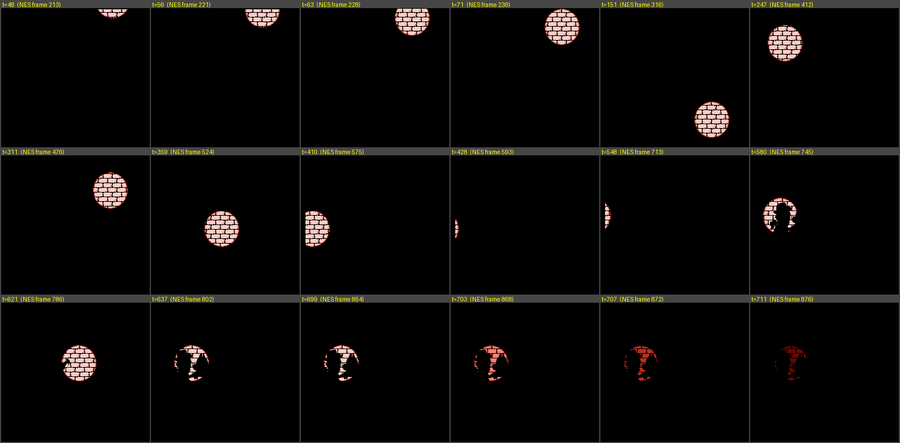

# 01 聚光灯开场（版权画面之后、标题画面之前）

## 导入 GMS 1.4

| 资源 | 名字 | 文件 | 注意 |
|---|---|---|---|
| Sprite | `spr_spotlight` | `spr_spotlight_strip4.png` | 文件名带 `_strip4`，载入后自动是 4 帧 64×63（没自动切开就用 Edit Sprite → File → Create from Strip） |
| Background | `bg_spotlight_wall1` `bg_spotlight_wall2` | 同名 png | 载入时**不要勾** Remove Background / Smooth Edges |
| Sound | `snd_drumroll` `snd_applause` | 同名 wav | |
| Object | `obj_spotlight` | `obj_spotlight.gml` | Create / Step / Draw 各加一个 Execute Code，贴入对应的那一段 |
| Room | 随意 | | 256×240，Speed 60，背景色黑，放一个 `obj_spotlight`（位置随意） |

- 这个房间要排在标题画面房间的前面；还没有下一个房间时，先把 `room_goto_next()` 换成 `room_restart()`。
- Global Game Settings 里关掉 *Interpolate colors between pixels*。

## 逐帧时间线

`t` = 本场景第几帧 = Mesen 帧号 − 165（Mesen 帧号：开机后第 1 帧画面 = 1）。每一帧的坐标/状态见 `frames.csv`。

| t | Mesen 帧 | 内容 |
|---|---|---|
| 1–24 | 166–189 | 全黑（载入砖墙、调色板淡入；聚光灯停在屏幕上方外 (192,−62)，不检测按键） |
| 25–151 | 190–316 | ① 向下 2 px/帧 → (192,192)。t=48 第一次露出来 |
| 152–247 | 317–412 | ② 左上，x、y 各 −1.375 px/帧 → (60,60) |
| 248–311 | 413–476 | ③ 向右 2 px/帧 → (188,60) |
| 312–359 | 477–524 | ④ 左下，x −1.375、y +1.375 → (122,126) |
| 360–487 | 525–652 | ⑤ 向左 2 px/帧 → (−134,126)，t=431 起完全出屏 |
| 488 | 653 | 墙换成带剪影的 `wall2`，y 改为 104，**鼓点声**开始 |
| 488–621 | 653–786 | ⑥ 向右 2 px/帧 → (134,104)，t=544 重新露出来 |
| 622–637 | 787–802 | ⑦ 向左 4 px/帧 → 停在 (70,104) |
| 638 | 803 | **掌声+口哨**开始；之后停留 61 帧，不检测按键 |
| 699–714 | 864–879 | 淡出：每 4 帧暗一级（sprite 第 0→1→2→3 帧） |
| 715–722 | 880–887 | 全黑 |
| 723 | 888 | 标题画面第 1 帧，标题音乐从这一帧开始 |

**跳过**：t=25…638 之间 1P 手柄任意键"刚按下"的那一帧，聚光灯原地停住并开始同样的淡出（共 24 帧：4 帧原亮度 + 12 帧三级变暗 + 8 帧全黑），然后进入标题画面。

## 原理和细节

- 原版里聚光灯是 32 个 8×16 精灵拼成的圆（64×63 的图，圆心在图内 (32,31)），**画在背景层后面**；砖墙是背景层，砖缝和剪影是不透明的黑色，砖面是透明的，所以透过砖墙才看得到聚光灯。GMS 里就是：黑底 → 聚光灯 → 砖墙图。
- 坐标用小数累加，显示时向下取整（和原版的定点数结果完全一致）。
- 屏幕上边：原版精灵的 Y 小于 0 时整个精灵不显示，所以聚光灯是在 t=48、56、63、71 分四截"跳"出来的（代码里的 `cut`）。
- 屏幕左边：原版最左 8 列像素不显示精灵，那 8 列永远是黑的，已经直接画进两张砖墙图里，代码不用处理。
- 淡出的 4 级亮度是原版调色板的实际变化，颜色各不相同，所以做成了 sprite 的 4 帧。
- 两个音效是游戏的 $74（鼓点）和 $73（掌声+口哨）号声音。原版里跳过、换画面都**不会打断**它们；正常播放时掌声会延续到标题画面里约 2 秒。
- wav 是 Mesen 的原始输出（48 kHz，音量没有放大，开头去掉了音频驱动固有的 1.17 帧静音）。以后的音乐音效都按同一标准截取，相对音量才一致。
- Mesen 在第 170 帧（音频芯片复位）还会有一下很轻的"噗"声，是硬件副作用，没有做成资源。

## 验证

`obj_spotlight.gml` 里的代码已经用脚本逐帧执行，并和 Mesen 的画面逐像素比较：完整播放 722 帧，加上 14 种不同时刻/不同按键的跳过，全部一致；音效触发帧和进入标题画面的帧也一致。
