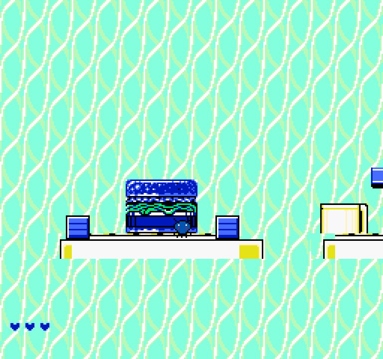

# Retro Recreations — Chip 'n Dale: Rescue Rangers 2 (NES) → GameMaker Studio 1.4

A from-scratch remake of the first stage ("Cheese Factory kitchen") of the US
release of **Chip 'n Dale Rescue Rangers 2**, rebuilt as a native
**GameMaker Studio 1.4.1760** project.

All artwork, sound effects and the background music were ripped directly from
the original cartridge at runtime (see [docs/PIPELINE.md](docs/PIPELINE.md)); no
original ROM code is reused — the game logic is written in GML.



## Open the project

1. Install **GameMaker Studio 1.4.1760** (the `.project.gmx` format is *not*
   forward compatible with GMS 2 / GameMaker 2024+).
2. Open `ChipNRangers2.project/ChipNRangers2.project.gmx`.
3. Press **F5** (Run).

The project targets 256×240 (NES resolution), window scale 3.

## Controls

| Action | Key |
| --- | --- |
| Move | ← → / A D |
| Jump | Space / Z |
| Pick up / drop / throw box | Shift / X |
| Start / confirm | Enter |
| Quit to title | Esc |

Throwing a box at an enemy (`kill_enemy` script) destroys it; walking into an
enemy while it is alive costs one heart. Hearts are displayed in the corner of
the screen by `objHUD`.

## What is implemented

* One full side-scrolling stage, 1,280 px wide (5 screens), ripped 1:1 for the
  opening screen and extended with original tile work for the rest.
* Player: run, variable-height jump, box pickup / carry / throw, damage +
  invulnerability flashing, lives, death and respawn.
* Boxes (`objCrate`) can be picked up, carried, dropped and thrown; a thrown
  box shatters on impact (`break_crate`) into particles and can kill enemies.
* Enemies (`objEnemy`) patrol their platform and reverse at their bounds.
* Pickups (`objHeart`), goal trigger (`objGoal`), stage clear screen
  (`objClear`) and game over screen (`objGameOver`).
* Title screen with the original logo art and a scrolling `bgmStage1` loop,
  HUD drawn on the GUI layer.

### Project contents

```
ChipNRangers2.project/
  ChipNRangers2.project.gmx     resource tree (GMS 1.4 format)
  sprites/        9 sprites   (sprPlayerIdle/Walk/Jump/Act, sprCrate,
                               sprEnemy, sprHeart, sprSpark, sprSolid)
  background/     3           (bgStage1 1280×240, bgTitle, bgGameOver)
  sounds/         8           (7 synthesised SFX + bgmStage1 music loop)
  objects/        12          (objGlobal, objTitle, objPlayer, objCrate,
                               objEnemy, objHeart, objSpark, objSolid,
                               objHUD, objGoal, objClear, objGameOver)
  scripts/        3           (break_crate, kill_enemy, scr_approach)
  rooms/          3           (rmTitle, rmStage1, rmGameOver)
  Configs/Default.config.gmx  Windows runner configuration
```

## Rebuilding the assets

Everything in `ChipNRangers2.project/` except the hand-written GML is
generated by the scripts in `tools/`; the intermediates live in `assets_src/`.

```bash
cd tools
python3 make_atlas.py      # CHR dump -> tiles_atlas.png + tiles_*.json
python3 render_map.py      # nametable render -> assets_src/map_raw.png
python3 gen_assets.py      # sprite PNGs (player frames, enemy, heart, spark)
python3 gen_crate.py       # sprCrate (drawn in the NES palette)
python3 gen_level.py       # bgStage1.png + level1.json (layout & platforms)
python3 gen_sounds.py      # SFX synthesis + bgm copy
python3 gen_project.py     # all .gmx files (sprites, objects, rooms, ...)
python3 preview_stage.py   # docs/preview_stage1_*.png
```

`gen_project.py` is the single source of truth for the project structure — it
emits the GameMaker XML *and* the GML for every event, so re-running it
regenerates the whole project deterministically.

## Source material & licensing

* ROM used for the rip: `Chip 'n Dale - Rescue Rangers 2 (USA).nes`
  (Mapper 1, MMC1, 16×16 KB PRG, 16×8 KB CHR) — **not** distributed with the
  original code, only used as an asset source.
* *Chip 'n Dale Rescue Rangers 2* is © Capcom / Disney. The ripped graphics,
  music and the ROM itself remain the property of their respective owners;
  this repository is a technical study, not a redistribution of the game.
* Original tooling and GML in this repository: GPLv3 (see `LICENSE`).
